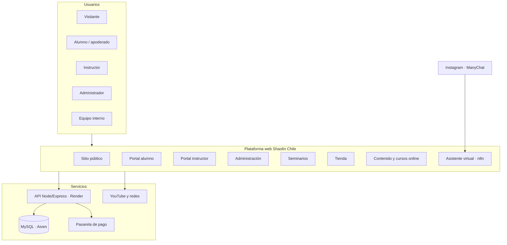

# Shaolin Chile — Plan Maestro del Sistema

13 de noviembre de 2026 · Markus

> Copia versionada del documento vivo [Plan Maestro del Sistema](https://claude.ai/artifact/UTcRcAgtEJ9eY6PNUyuztp). El documento vivo es la versión de referencia; esta copia se actualiza en cada sesión de trabajo.

Shaolin Chile tendrá una sola plataforma con seis frentes: sitio institucional, portal del alumno, portal del instructor, administración, seminarios con venta de entradas y tienda. Este documento fija la estructura antes de seguir programando, y define las responsabilidades de cada integrante del equipo.

## Visión y alcance

La plataforma es la casa digital de la organización: presenta la escuela al público y, al mismo tiempo, administra su operación diaria. Sirve a cinco públicos distintos, cada uno con su propia puerta de entrada.

| Público | Qué necesita de la plataforma |
| --- | --- |
| Visitante | Conocer la escuela, sus lineamientos, disciplinas y sedes; inscribirse o comprar |
| Alumno | Ver su estado de cuenta, pagar, agendar clases y revisar su progreso |
| Instructor | Ver sus clases, alumnos, disponibilidad, pagos y liquidaciones |
| Administrador | Asignar instructores y sedes, gestionar horarios, cobros, seminarios y tienda |
| Comprador | Adquirir artículos o entradas a seminarios sin necesidad de ser alumno |

**Fuera de alcance en la primera versión:** aplicación móvil nativa, clases en vivo por streaming y facturación electrónica automática con el SII. Se evaluarán una vez estabilizado el núcleo.

## Arquitectura

Todos los módulos comparten una sola API y una sola base de datos, con acceso controlado por rol. Así, un alumno que compra en la tienda o una entrada a un seminario usa la misma cuenta y el mismo medio de pago que para su mensualidad.

## Módulos y funcionalidades

El sistema se divide en ocho módulos. Cada uno puede construirse y entregarse por separado, en el orden de la hoja de ruta.

| Módulo | Funcionalidades principales | Usuarios |
| --- | --- | --- |
| 1. Sitio institucional | Inicio, historia y linaje, lineamientos y código de conducta, disciplinas (Kung Fu Tradicional, Sanda, Tai Chi y Qi Gong, cursos online), sedes con mapa y horarios, planes y precios, reserva de clase de prueba gratuita, directorio oficial de instructores y escuelas acreditadas, política de privacidad, contacto, preguntas frecuentes | Público |
| 2. Portal del alumno | Perfil y ficha médica, cuenta familiar (un apoderado gestiona y paga por varios alumnos, con descuento familiar), estado de cuenta, pago en línea, clases disponibles, agenda y cancelación, historial de asistencia, grado actual y avance hacia los requisitos del próximo examen, cursos online contratados, solicitud de copia o eliminación de sus datos | Alumno, apoderado |
| 3. Portal del instructor | Clases asignadas y lista de alumnos, toma de asistencia, disponibilidad semanal, liquidaciones y estado de pagos, alumnos habilitados para rendir examen, registro de avances, nivel de certificación propio | Instructor |
| 4. Administración | Usuarios y roles, sedes, horarios y cupos, asignación de instructores, planes y cobros, morosidad y recuperación de pagos fallidos (avisos y reintentos automáticos), seguimiento de interesados desde la clase de prueba hasta la inscripción, alerta de alumnos que dejan de asistir, exámenes de grado, certificación de instructores y escuelas afiliadas, gestión de convenios con organizaciones (agregar, editar, pausar o dar de baja), reportes, bitácora de cambios | Administrador |
| 5. Seminarios por temporada | Temporadas de seminarios por fines de semana (viernes a domingo), compra de uno o varios fines de semana y de varias entradas en una sola compra, promociones para escuelas de kung fu y otras organizaciones (detalle en la sección del módulo 5); ficha con video promocional, fecha, horario, ubicación, instructor invitado y cupos; precio de preventa y descuento para alumnos; venta de entradas con código QR; aceptación de exención de responsabilidad al comprar; control de acceso el día del evento; certificado de participación descargable | Público, alumno, administrador |
| 6. Tienda | Catálogo por categoría (armas de entrenamiento, vestimenta, decoración, libros y accesorios), tallas y variantes, stock, carro de compra, pago con boleta electrónica, despacho o retiro en sede, seguimiento de pedidos | Público, alumno, encargado de catálogo |
| 7. Contenido y formación online | Galería de videos y fotos, noticias, avisos internos, correos automáticos (bienvenida, cobro, recordatorio de clase), cursos online pagados por nivel con acceso por alumno | Encargado de contenido, administrador |

**Pagos:** en el primer lanzamiento, los pagos se reciben por transferencia bancaria directa y la administración los valida en la plataforma. Más adelante se incorporará una pasarela chilena (Webpay de Transbank, Mercado Pago o Flow) compartida por mensualidades, entradas y tienda, para tener una sola conciliación de ingresos.

**Grados y certificación:** es la funcionalidad que distingue a los sistemas especializados en artes marciales de un sistema de reservas genérico. Cada grado define requisitos (clases mínimas, tiempo mínimo en el grado y técnicas exigidas); el sistema calcula quién está habilitado, José Cuevas aprueba la nominación, se cobra el derecho a examen y, una vez aprobado, el grado queda registrado en la ficha del alumno. La certificación de instructores y escuelas afiliadas sigue el mismo modelo, por niveles.

## Módulo 5 — Seminarios por temporada

Los seminarios se organizan en temporadas. Por ejemplo, la temporada de diciembre ofrece un seminario cada fin de semana del mes, de viernes a domingo. Cada interesado se registra, elige uno o varios fines de semana, compra una o varias entradas y paga todo en una sola compra.

**Estructura**

| Concepto | Definición | Ejemplo |
| --- | --- | --- |
| Temporada | Conjunto de seminarios de un período, con su video promocional y su programa | Temporada Diciembre 2026 |
| Fin de semana | Un seminario de viernes a domingo, con sede, horario, instructores, temática y cupo propios | Viernes 4 a domingo 6 de diciembre |
| Entrada | Derecho de una persona a asistir a un fin de semana; es nominativa y lleva su código QR | Entrada de Juan Pérez para el 4 al 6 de diciembre |
| Compra | El pago único de un comprador, que puede reunir varias entradas para varios fines de semana | 3 entradas para 2 fines de semana: 6 entradas en total |

**Flujo de compra**

1. El interesado ve la temporada con el calendario de fines de semana, el cupo disponible de cada uno y el video promocional.
2. Elige uno o varios fines de semana y la cantidad de entradas para cada uno.
3. Aplica una promoción, si corresponde: código de convenio, descuento por grupo o pack de temporada.
4. Paga una sola vez por transferencia bancaria y sube el comprobante; la administración valida el pago y el comprador recibe un correo con la confirmación y la boleta.
5. Asigna el nombre de cada asistente a cada entrada, en ese momento o después, hasta una fecha límite antes del fin de semana; cada asistente acepta la exención de responsabilidad y recibe su QR.
6. El día del seminario se controla el acceso con el QR y, al terminar, cada asistente descarga su certificado de participación.

**Productos del primer lanzamiento**

| Producto | Duración | Precio | Cupo |
| --- | --- | --- | --- |
| Clase (Taller de Iniciación) | 2 a 3 horas, sábado en la mañana | $35.000 | 50 por clase |
| Seminario de fin de semana | Viernes a domingo (3 días) | $75.000 | 50 por fin de semana |
| Poleras y artículos | Venta junto con las entradas | Según catálogo | Según stock |
| Clase online | Acceso a los videos de la clase contratada, con derecho a descarga | $25.000 | Sin límite |

**Catálogo de prueba de la tienda**

Catálogo provisorio para construir y probar la tienda. Los precios y el stock son referenciales y los reemplazará Maxi Muñoz con el catálogo definitivo.

| Código | Producto | Categoría | Variantes | Precio de prueba | Stock de prueba |
| --- | --- | --- | --- | --- | --- |
| VES-001 | Polera oficial Shaolin Chile (algodón) | Vestimenta | Tallas S, M, L, XL, XXL · negra o blanca | $15.000 | 10 por variante |
| VES-002 | Polerón oficial con capucha | Vestimenta | Tallas S, M, L, XL · negro | $28.000 | 5 por variante |
| VES-003 | Pantalón de entrenamiento | Vestimenta | Tallas S, M, L, XL · negro | $22.000 | 5 por variante |
| VES-004 | Faja de entrenamiento | Vestimenta | Colores según grado | $8.000 | 10 por color |
| VES-005 | Zapatillas de entrenamiento de lona | Vestimenta | Tallas 36 a 45 | $25.000 | 3 por talla |
| ACC-001 | Jockey bordado | Accesorios | Talla única · negro | $10.000 | 15 |
| ACC-002 | Botella de agua metálica | Accesorios | 750 ml | $9.000 | 15 |
| ACC-003 | Bolso deportivo | Accesorios | Único | $20.000 | 8 |
| ARM-001 | Espada de tai chi de madera (entrenamiento) | Armas de entrenamiento | 90 cm | $18.000 | 6 |
| ARM-002 | Bastón largo de madera (gun) | Armas de entrenamiento | 1,60 m o 1,80 m | $20.000 | 4 por largo |
| DEC-001 | Cuadro caligrafía "Chan" | Decoración | 30 x 40 cm | $15.000 | 5 |

Las armas de entrenamiento son de madera, sin filo, y se publican con advertencia de uso y edad mínima.

**Promociones**

| Tipo | Para quién | Cómo funciona |
| --- | --- | --- |
| Alumno Shaolin Chile | Alumnos con matrícula vigente | Descuento automático al comprar desde su cuenta |
| Preventa | Público general | 35 % de descuento para los primeros 15 cupos pagados de cada fin de semana |
| Pack de temporada | Quien compra varios fines de semana | Descuento al comprar dos o más fines de semana, mayor si compra la temporada completa |
| Escuelas de kung fu | Escuelas de kung fu externas | Convenio con código propio: 10 % de descuento y cupos liberados que la administración asigna en cada convenio, para delegaciones de 5 o más |
| Otras organizaciones | Escuelas de otras artes marciales, clubes, gimnasios, empresas | Convenio con código propio: 10 % de descuento y cupos liberados que la administración asigna en cada convenio, para delegaciones de 5 o más |
| Grupo | Cualquier comprador | Descuento por cantidad de entradas en una misma compra (por ejemplo, desde 5) |

**Gestión de convenios:** en este momento no hay organizaciones definidas. La administración tiene una sección de convenios para agregar, editar, pausar o dar de baja organizaciones cuando corresponda. Cada convenio registra:

- organización y tipo (escuela de kung fu u otra organización)
- representante y datos de contacto
- código propio
- porcentaje de descuento (10 % por defecto)
- cupos liberados asignados
- vigencia
- estado (activo, pausado o dado de baja)

Dar de baja un convenio desactiva su código, pero conserva su historial de compras para los reportes; no se borra.

Las organizaciones con convenio tienen un representante con cuenta propia. Ese representante compra un bloque de entradas para su grupo y luego asigna los nombres de los asistentes. Las promociones no se acumulan, salvo que la dirección lo defina, y cada una tiene vigencia y tope de usos.

**Política de cambios y devoluciones (propuesta, a validar con abogado)**

Basada en la Ley del Consumidor (Ley 19.496, modificada por la Ley 21.398) y en los criterios del SERNAC:

| Caso | Política |
| --- | --- |
| Retracto en entradas y clases | Dentro de 10 días desde la compra y antes del inicio del seminario o clase: devolución total, sin expresar causa. Es el derecho legal por defecto en compras a distancia; solo se puede excluir si se informa de forma expresa antes del pago |
| Cambio de fin de semana | Sin costo, sujeto a cupo, hasta el cierre de inscripciones (12 horas antes del inicio) |
| Cambio de asistente | La entrada nominativa se puede traspasar a otra persona hasta el cierre de inscripciones |
| Inasistencia | Sin devolución fuera del plazo de retracto; se ofrece cambio a otro fin de semana de la misma temporada, sujeto a cupo |
| Cancelación o reprogramación por la escuela | El comprador elige entre devolución total o cambio a otra fecha. Se avisa de inmediato por correo e Instagram |
| Clase online con videos | Retracto dentro de 10 días, solo si aún no se ha visto ni descargado el video; al verlo o descargarlo, el servicio se considera prestado. Esto se informa de forma expresa antes del pago |
| Poleras y artículos | Retracto de 10 días desde la recepción, sin uso y con etiquetas. Garantía legal de 6 meses por fallas: el comprador elige cambio, reparación o devolución. Cambio de talla dentro de 30 días, como beneficio de la escuela |
| Plazo de devolución | Por transferencia a la cuenta del comprador, dentro de 10 días hábiles desde la solicitud aprobada |

La política se publica en el sitio y se acepta al comprar, antes del pago.

**Reglas de operación**

- El cupo se descuenta por fin de semana. Al iniciar el pago, las entradas quedan reservadas por un tiempo breve (por ejemplo, 15 minutos) para no vender dos veces el mismo lugar.
- Si un fin de semana se llena, se ofrece lista de espera.
- Las inscripciones de cada clase y fin de semana se cierran 12 horas antes de su inicio; las compras con transferencia pendiente a esa hora se anulan.
- El asistente virtual informa sobre la temporada y envía el enlace de compra, pero el pago siempre se hace en la plataforma.
- Reportes para la administración: entradas vendidas y asistentes por fin de semana, ingresos por temporada y ventas por promoción y por organización.

## Módulo 8 — Asistente virtual

Un agente de inteligencia artificial atiende las consultas del público en la página web y en Instagram, asesora, agenda clases de prueba y envía correos. Así, José Cuevas deja de responder consultas y se concentra en la enseñanza; los casos que el agente no puede resolver pasan a la administración.

**Qué hace**

- Responde sobre lineamientos, disciplinas, sedes, horarios, precios, seminarios y tienda, usando solo una base de conocimiento validada por José Cuevas.
- Muestra clases disponibles y reserva la clase de prueba, registrando al interesado con su origen (web o Instagram).
- Envía correos de confirmación, recordatorio y bienvenida.
- Deriva a la administración cuando no sabe la respuesta, hay un reclamo, un tema médico o la persona pide hablar con alguien.

**Herramienta elegida: n8n**

| Criterio | n8n | Hermes Agent |
| --- | --- | --- |
| Propósito | Automatizar procesos de un negocio | Asistente personal de una persona |
| Instagram (conversación) | Sí, vía API de Meta o ManyChat | Sin conexión disponible; solo publicación |
| Agendar y correos | Nodos incluidos (agente de IA, Gmail, llamadas a la API) | Requiere programar integraciones |
| Mantenimiento | Flujos visuales, ajustables sin programar | Requiere programar |
| Costo | Gratis en servidor propio (unos USD 3 a 7 al mes) más el modelo de IA | Gratis más el modelo de IA |

**Arquitectura**

1. Canales: chat insertado en la página web e Instagram; al comienzo vía ManyChat, ya aprobado por Meta, y luego con la API directa de Meta.
2. Cerebro: agente en n8n con la base de conocimiento de la escuela.
3. Acciones: el agente llama a la API propia de Shaolin Chile (clases disponibles, reservas, interesados), no a un calendario externo, para que todo quede en un solo sistema.
4. Registro: cada conversación queda guardada y vinculada al interesado.

**Reglas del agente**

- Se presenta como asistente virtual, como exige Meta.
- No inventa precios, horarios ni datos; si no los tiene, deriva.
- No entrega consejos médicos ni de lesiones.
- Pide consentimiento antes de guardar datos personales (Ley 21.719).
- En Instagram responde solo dentro de las 24 horas posteriores al último mensaje de la persona; fuera de ese plazo responde un humano.

**Requisitos de Instagram:** cuenta profesional vinculada a una página de Facebook; para usar la API directa, revisión de la aplicación y verificación de la empresa por parte de Meta.

**Indicadores:** porcentaje de consultas resueltas sin intervención humana, clases de prueba agendadas por el asistente y tiempo de respuesta.

## Roles y permisos

Se proponen siete roles. Una persona puede tener más de uno (por ejemplo, Benja es alumno e instructor), por lo que el usuario debe poder acumular roles en lugar de tener uno solo, como ocurre hoy.

| Rol | Puede ver | Puede modificar |
| --- | --- | --- |
| Director (super administrador) | Todo el sistema, incluidos ingresos y bitácora | Todo; único que crea administradores, cambia precios y otorga certificaciones |
| Administrador | Usuarios, sedes, horarios, cobros, morosidad, interesados, seminarios, tienda, reportes | Asignaciones, horarios, cupos, alumnos, instructores, seminarios, exámenes |
| Instructor (por nivel de certificación) | Sus clases, sus alumnos, su disponibilidad y sus liquidaciones | Asistencia, disponibilidad, notas de avance y nominación de alumnos a examen |
| Encargado de catálogo | Productos, stock y pedidos | Productos, precios propuestos, stock, estado de pedidos |
| Encargado de contenido | Galería, noticias, seminarios publicados y cursos online | Videos, fotos, noticias, material promocional y lecciones |
| Apoderado | Fichas, estado de cuenta y asistencia de los alumnos a su cargo | Datos de contacto, reservas, pagos y autorizaciones de sus representados |
| Alumno | Su perfil, estado de cuenta, clases, reservas, grado y cursos | Su perfil, reservas y pagos propios |

Principio de mínimo privilegio: cada rol ve solo lo que necesita. Los datos de salud y de pago de los alumnos son visibles únicamente para el propio alumno, su instructor (salud) y la administración.

## Modelo de datos

La base actual tiene seis tablas (roles, usuarios, detalles\_alumno, horarios, reservas\_alumno y representantes). El sistema completo necesita las siguientes entidades, agrupadas por módulo.

| Grupo | Tablas | Observación |
| --- | --- | --- |
| Identidad | usuarios, roles, usuario\_roles, familias, familia\_miembros | Muchos a muchos para acumular roles; la familia agrupa al apoderado y sus alumnos |
| Escuela | sedes, disciplinas, grados, requisitos\_grado, perfiles\_alumno, perfiles\_instructor | Cada alumno pertenece a una sede y tiene un grado vigente |
| Grados y certificación | examenes, inscripciones\_examen, historial\_grados, niveles\_certificacion, certificaciones\_instructor, escuelas\_afiliadas | La habilitación se calcula cruzando requisitos\_grado con asistencias |
| Captación | interesados, clases\_prueba, seguimientos, conversaciones\_asistente | Registra el origen del interesado (redes, sitio, referido) para medir campañas |
| Clases | clases (plantilla semanal), sesiones (fecha concreta), reservas, asistencias, disponibilidad\_instructor | Separar la plantilla de la sesión permite cancelar o reprogramar un día puntual |
| Finanzas | planes, descuentos, suscripciones, cargos, pagos, intentos\_cobro, liquidaciones\_instructor, boletas | El estado de cuenta se calcula como cargos menos pagos; intentos\_cobro sostiene la recuperación de pagos fallidos |
| Seminarios | temporadas, fines\_semana\_seminario, compras\_seminario, entradas, promociones, convenios\_organizacion, lista\_espera, exenciones\_firmadas, certificados\_participacion | Cada entrada pertenece a un fin de semana y a un asistente, y lleva un código único para el QR; una compra agrupa varias entradas |
| Tienda | categorias, productos, variantes (talla, color), movimientos\_stock, pedidos, items\_pedido | El stock se lleva por variante, no por producto |
| Contenido y cursos | medios, noticias, avisos, cursos, lecciones, accesos\_curso | Los videos se alojan en YouTube o Vimeo (privados en el caso de cursos); la base guarda el enlace |
| Privacidad y auditoría | consentimientos, solicitudes\_datos, bitacora | Qué aceptó cada persona y cuándo; solicitudes de acceso o eliminación; quién cambió qué |

Se recomienda manejar los cambios de esquema con migraciones versionadas (por ejemplo, Knex o Prisma) en lugar de scripts sueltos, para que todos trabajen sobre la misma estructura.

## Protección de datos y cumplimiento legal

La Ley 21.719 de protección de datos personales entra en vigencia el 1 de diciembre de 2026, salvo que se apruebe el proyecto de postergación en trámite en el Senado. La plataforma guardará datos de salud (datos sensibles) y datos de menores de edad, por lo que el cumplimiento debe diseñarse desde el inicio y no agregarse después.

- **Consentimiento explícito** al registrarse, separado para datos de salud, uso de imagen y comunicaciones.
- **Menores de edad:** el apoderado registra al alumno y otorga las autorizaciones.
- **Política de privacidad** publicada en el sitio, que indique qué datos se recogen, para qué y por cuánto tiempo.
- **Derechos del titular:** cada persona puede pedir acceso, rectificación, eliminación u oposición desde su portal; la administración responde dentro del plazo legal.
- **Seguridad:** contraseñas cifradas, acceso por rol, bitácora de cambios y respaldos periódicos de la base de datos.
- **Exención de responsabilidad** para clases y seminarios, aceptada en línea y guardada con fecha.
- **Boleta electrónica:** las ventas a público final (tienda, entradas, mensualidades) probablemente requieren boleta electrónica del SII; se debe elegir una pasarela o servicio que la emita.

Ambos temas, ley de datos y tributación, deben validarse con un abogado y un contador antes de la Fase 2.

## Diagnóstico del repositorio actual

El repositorio `shaolin-chile` tiene una base funcional que conviene conservar: landing con secciones, login con JWT, panel de administración y panel de alumno, desplegados en Render con MySQL. Antes de construir encima hay que corregir problemas de seguridad y orden.

**Lo que existe hoy**

| Componente | Estado | Decisión |
| --- | --- | --- |
| `index.html` (inicio, el camino, disciplinas, sedes, contacto, registro de representantes) | Funcional, contenido parcial | Conservar diseño; reorganizar en páginas del módulo 1 |
| `admin-dashboard.html` (usuarios y horarios) | Funcional básico | Base del módulo 4 |
| `alumno-dashboard.html` (reservas) | Funcional básico | Base del módulo 2 |
| Backend Express + MySQL (login, usuarios, horarios, reservas) | Funcional; editar horario no está implementado | Reestructurar por módulos |
| Roles: Desarrollador, Administrador, Colaborador, Externo, Alumno | Un rol por usuario; no existe rol Instructor | Reemplazar por los roles de este plan |

**Problemas a corregir antes de seguir (prioridad alta)**

1. El archivo `backend/.env` está subido al repositorio con las credenciales de la base de datos y la clave JWT. Hay que cambiar esas claves en Aiven y Render, sacar el archivo del repositorio y agregar un `.gitignore`.
2. Los scripts `seed_admin.js`, `seed_alumno.js` y `seed_custom_admins.js` contienen contraseñas escritas en el código. Deben cambiarse y leerse desde variables de entorno.
3. Si falta `JWT_SECRET`, el servidor usa una clave por defecto conocida; debe negarse a arrancar.
4. CORS acepta cualquier origen; debe limitarse al dominio del sitio.
5. Archivos sobrantes: `push_error.txt`, `seed_error.log` y `representantes.db` (SQLite sin uso, ya que el sistema usa MySQL).
6. El push directo a `main` está bloqueado por reglas del repositorio: el equipo debe trabajar con ramas y pull requests (ver lineamientos).

**Problemas de estructura (prioridad media)**

- No hay migraciones: el esquema está repartido entre `database_schema.sql` y `setup_intranet_db.js`.
- La URL del backend está repetida en cada HTML; debe ir en un solo archivo de configuración.
- No hay pruebas automatizadas ni validación de datos de entrada.
- Los horarios usan día de la semana sin fecha, lo que impide cancelar o reprogramar una clase puntual.

**Recomendación técnica:** mantener Node.js, Express y MySQL, que ya están desplegados, y ordenar el backend en carpetas por módulo (`auth`, `alumnos`, `clases`, `finanzas`, `seminarios`, `tienda`, `contenido`). Cuando el frontend crezca, migrar los HTML a un framework con componentes (por ejemplo, Next.js o Vue) para no duplicar menús y encabezados.

## Hoja de ruta por fases

Se proponen cinco fases secuenciales. Una fase se da por cerrada solo cuando cumple su criterio de cierre; las duraciones son estimaciones a confirmar según la disponibilidad del equipo.

1. **Fase 0 — Ordenar la base (1 a 2 semanas).** Corregir los seis problemas de prioridad alta del diagnóstico, definir ramas y flujo de trabajo, crear migraciones y la nueva estructura de roles, incluidas familias y consentimientos.
   - Cierre: ninguna credencial en el repositorio, claves rotadas y la base creada desde migraciones.
2. **Fase 1 — Sitio institucional (2 a 3 semanas).** Inicio, lineamientos, disciplinas, sedes, planes, reserva de clase de prueba, política de privacidad, contacto y galería básica.
   - Cierre: contenido aprobado por la dirección y por José Cuevas; sitio publicado en el dominio oficial y recibiendo solicitudes de clase de prueba.
3. **Fase 2 — Portales de alumno, instructor y administración (5 a 7 semanas).** Sedes, clases y sesiones, reservas, asistencia, disponibilidad, cuentas familiares, estado de cuenta, morosidad, seguimiento de interesados, requisitos de grado, exámenes y asistente virtual en la página web.
   - Cierre: una sede piloto opera un mes completo en el sistema, con asistencia, cobros y al menos una ronda de exámenes registrados; validación legal de datos personales aprobada.
4. **Fase 3 — Pagos, tienda y seminarios (4 a 6 semanas).** Pasarela de pago con boleta electrónica, recuperación de pagos fallidos, catálogo, pedidos, seminarios por temporada con compra de varios fines de semana y varias entradas, promociones y convenios con organizaciones, preventa, descuento para alumnos, exención firmada, entradas con QR, certificado de participación y asistente virtual en Instagram.
   - Cierre: primera venta real de un producto y de una entrada, conciliadas con la pasarela y con su boleta emitida.
5. **Fase 4 — Crecimiento (permanente).** Certificación de instructores y escuelas afiliadas con directorio público, cursos online pagados, reportes, liquidaciones automáticas y notificaciones.
   - Cierre: revisión trimestral de indicadores con el equipo.

## Lineamientos generales del equipo

Todos los integrantes representan a la organización dentro y fuera de la plataforma. Estas reglas aplican a cada rol, además de sus responsabilidades específicas.

**Conducta e imagen**

- Actuar conforme a los principios de la escuela: respeto, disciplina, humildad y constancia.
- Todo contenido público (textos, fotos, videos, productos) se publica con la línea gráfica y el tono oficial: profesional, sobrio y respetuoso de la tradición.
- Nada sale publicado en nombre de Shaolin Chile sin la aprobación del responsable del área y, cuando corresponda, de la dirección.

**Datos y accesos**

- Cada persona usa su propia cuenta; las contraseñas no se comparten ni se envían por chat.
- Los datos de alumnos (contacto, salud, pagos) son confidenciales y se usan solo para fines de la escuela.
- Fotos o videos de alumnos se publican solo con su autorización escrita, y la de su apoderado si es menor de edad.

**Comunicación y seguimiento**

- Un canal oficial del equipo para coordinación y un tablero de tareas compartido (por ejemplo, Trello, ClickUp o GitHub Projects).
- Reunión semanal de 30 minutos: avances, bloqueos y prioridades de la semana.
- Cada tarea tiene un responsable y una fecha; si no se puede cumplir, se avisa antes del plazo, no después.

**Trabajo en el código** (para quienes participen del desarrollo)

- Nadie sube cambios directo a `main`: cada cambio va en una rama y entra por pull request revisado.
- Nunca se suben claves, contraseñas ni archivos `.env` al repositorio.
- El desarrollo se trabaja en el computador del director, con Claude Code en la terminal sobre la carpeta local del proyecto; cada sesión termina con sus cambios subidos a GitHub en una rama.
- Este plan maestro se versiona también en el repositorio, en `docs/plan-maestro.md`.

## Maxi Muñoz — Encargado de Catálogo de Productos

Maxi es responsable de que la tienda tenga un catálogo completo, correcto y atractivo, con stock real. Su rol está pensado para crecer por etapas hacia la gestión completa del comercio de la escuela.

**Responsabilidades**

- Definir las categorías y subcategorías: armas de entrenamiento, vestimenta (uniformes, fajas, calzado), decoración, libros y accesorios.
- Crear y mantener la ficha de cada producto: nombre, descripción, material, medidas, tallas, precio propuesto y al menos tres fotos con fondo neutro.
- Llevar el stock por variante (talla y color) y avisar cuando un producto baje del mínimo acordado.
- Proponer precios con su costo y margen; la dirección aprueba el precio final.
- Revisar que las armas de entrenamiento se publiquen con su advertencia de uso, edad mínima y la normativa chilena aplicable.

**Primeras tareas (Fase 0 y Fase 1)**

- [ ] Levantar el inventario actual en una planilla: producto, variante, cantidad, costo y proveedor.
- [ ] Proponer la estructura de categorías y los campos de la ficha de producto.
- [ ] Preparar las fichas de los primeros 20 productos, priorizando uniformes y fajas.
- [ ] Definir una guía de fotografía de productos (fondo, luz, ángulos, tamaño).

**Indicadores**

- Porcentaje de productos con ficha completa (meta: 100 % antes de abrir la tienda).
- Diferencia entre stock del sistema y stock físico en el conteo mensual (meta: menor a 2 %).
- Tiempo de preparación de pedidos (meta: 48 horas hábiles).

**Crecimiento del rol**

| Etapa | Responsabilidades que se agregan |
| --- | --- |
| 1. Catálogo | Fichas, fotos, categorías y stock |
| 2. Pedidos | Preparación, despacho o retiro en sede, verificación de boleta emitida, cambios y devoluciones |
| 3. Proveedores | Cotizaciones, compras, negociación y reposición |
| 4. Comercial | Promociones, packs para alumnos nuevos, merchandising de seminarios y reporte mensual de ventas |

## Benja Muñoz — Contenido Audiovisual y Redes, Alumno Avanzado e Instructor

Benja tiene un rol doble: es la voz visual de la escuela en redes sociales y, a la vez, instructor en formación. Responde a la dirección por el contenido y a José Cuevas por la parte técnica e instruccional.

**Responsabilidades en contenido**

- Publicar en redes sociales según un calendario mensual aprobado (meta inicial: tres publicaciones por semana).
- Producir los videos promocionales de cada seminario: anuncio, anuncio de preventa, recordatorio a una semana y resumen posterior.
- Subir a la plataforma los videos de seminarios, la galería y las noticias.
- Mantener un archivo ordenado de material crudo (fecha, sede, evento) y verificar en la plataforma que cada alumno que aparece tenga su autorización de imagen vigente. En la Fase 4, grabar y editar los cursos online junto a José Cuevas.
- Responder mensajes y comentarios con las respuestas tipo aprobadas, e invitar a cada interesado a reservar su clase de prueba en el sitio, para que quede registrado su origen.

**Responsabilidades como instructor**

- Dirigir las clases que se le asignen, principalmente niveles iniciales, con el programa definido por José Cuevas.
- Tomar asistencia en la plataforma en cada clase y registrar observaciones de los alumnos.
- Mantener su disponibilidad semanal actualizada en el portal del instructor.
- Continuar su propia formación y rendir sus exámenes de grado según el calendario oficial.

**Primeras tareas**

- [ ] Proponer la línea gráfica para redes: tipografía, colores, plantillas y uso del logo.
- [ ] Preparar el calendario de contenidos del primer mes.
- [ ] Grabar material base: clases por disciplina, sedes y entrevistas breves a instructores.
- [ ] Producir un video de presentación de la escuela de 60 a 90 segundos para el sitio institucional.
- [ ] Convertir la cuenta de Instagram en profesional, vincularla a la página de Facebook y conectarla al asistente virtual mediante ManyChat.

**Indicadores**

- Cumplimiento del calendario de publicaciones (meta: 90 %).
- Crecimiento mensual de seguidores y de clases de prueba agendadas desde redes.
- Entradas vendidas por seminario atribuibles a la campaña.
- Asistencia y permanencia de los alumnos de sus clases.

## José Cuevas — Instructor Principal

José es la autoridad técnica de la escuela: define qué se enseña, cómo se enseña y quién está preparado para avanzar o para enseñar. Responde directamente a la dirección.

**Responsabilidades**

- Definir y documentar el programa técnico de cada disciplina y nivel: contenidos, formas, requisitos y tiempos mínimos por grado.
- Dirigir los exámenes de grado y aprobar las promociones que se registran en la plataforma.
- Formar, supervisar y evaluar a los instructores, incluido Benja Muñoz, con al menos una clase observada al mes por instructor.
- Validar los lineamientos de conducta, seguridad y protocolo de sala que se publican en el sitio.
- Validar el contenido técnico de videos y publicaciones antes de su salida.
- Asesorar técnicamente la selección de armas y vestimenta del catálogo, en coordinación con Maxi Muñoz.
- Proponer y coordinar seminarios: temática, instructores invitados, fechas y requisitos de participación. En la Fase 4, definir el contenido de los cursos online por nivel.
- Dirigir sus propias clases y mantener su disponibilidad y asistencia al día en la plataforma.

**Primeras tareas**

- [ ] Entregar el programa por grados de Kung Fu Tradicional, Sanda y Tai Chi y Qi Gong, con los requisitos de cada grado: clases mínimas, tiempo mínimo en el grado y técnicas exigidas.
- [ ] Revisar y aprobar el texto de lineamientos y código de conducta para el sitio.
- [ ] Definir el calendario anual de exámenes de grado y la propuesta de seminarios del próximo semestre.
- [ ] Diseñar la certificación de instructores en niveles (por ejemplo, asistente, instructor y maestro), con requisitos, evaluación y renovación, como base del directorio oficial y de las escuelas afiliadas.
- [ ] Validar la base de conocimiento del asistente virtual (preguntas frecuentes, lineamientos, criterios de derivación) y revisar cada mes una muestra de conversaciones.
- [ ] Entregar o validar sus textos publicados en shaolinguan.cl (filosofía, lineamientos, historia) para integrarlos al sitio como contenido oficial, con su autoría.

**Indicadores**

- Alumnos que rinden y aprueban examen por período.
- Retención de alumnos a tres y seis meses por sede.
- Instructores evaluados en el mes (meta: 100 %).

## Decisiones pendientes

Estas definiciones bloquean el inicio de la Fase 1 o de la Fase 3 y corresponden a la dirección.

- [ ] ¿Quién cumple el rol de administrador día a día, además de la dirección?
- [ ] ¿Qué pasarela de pago se usará (Webpay, Mercado Pago o Flow)?
- [ ] ¿Cómo se calculan los pagos a instructores: monto fijo, por clase dictada o por alumno activo?
- [ ] ¿Qué sedes estarán activas al lanzamiento, además de la Región Metropolitana y la Región del Maule?
- [ ] ¿Dominio oficial del sitio y correo institucional para el equipo?
- [ ] ¿La tienda despachará a todo Chile o solo retiro en sede al comienzo?
- [ ] Seminarios: ¿precio del retiro?, ¿catálogo definitivo de la tienda (reemplaza el de prueba)?, ¿validación legal de la política de cambios y devoluciones?
- [ ] ¿Se mantiene el registro de representantes de sede como función del sitio?
- [ ] ¿Construir todo el sistema o combinar? Recomendación: construir, porque la base existe y la identidad de la organización es central; la alternativa es arrendar la gestión de clases y cobros (por ejemplo, AgendaPro o Gymdesk) y construir solo sitio, seminarios, tienda y certificación.
- [ ] ¿Qué política de morosidad se aplica: cuántos días de gracia y cuándo se suspende la reserva de clases?
- [ ] ¿Descuento familiar y descuento de alumno en seminarios: qué porcentajes?
- [ ] ¿Niveles de certificación de instructores y escuelas afiliadas, y su costo?
- [ ] ¿Quién asesora en ley de datos personales y quién en boleta electrónica (abogado y contador)?
- [ ] Asistente virtual: ¿n8n en Render junto al backend o en un servidor aparte?, ¿qué modelo de IA usar?, ¿ManyChat al inicio o API directa de Meta? Confirmar con n8n que la licencia gratuita cubre un chat de atención en el sitio propio.

## Fuentes

Referentes revisados para completar este plan:

- Software para escuelas de artes marciales: [Gymdesk, seguimiento de grados](https://gymdesk.com/blog/martial-arts-belt-tracking-software), [Zen Planner](https://zenplanner.com/?p=31871), [BlackBeltCRM](https://blackbeltcrm.com/?p=14480), [Classcard, comparativa 2026](https://www.classcardapp.com/blog/martial-arts-school-management), [AgendaPro Chile](https://agendapro.com/cl/centro-deportivo/software-para-centro-deportivo)
- Organizaciones Shaolin: [certificación de instructores, Shaolin Yanxu](https://www.shaolinyanxu.com/instructor-certification), [curso online, Shaolin Yanxu](https://shaolinyanxu.com/course/shaolin-beginner-program), [USA Shaolin Temple](https://usashaolintemple.com/shaolintraining)
- Asistente virtual: [plantilla n8n Instagram + agenda](https://n8n.io/workflows/11771-book-beauty-appointments-and-answer-faqs-with-gpt-4-google-calendar-gmail-and-instagram/), [Meta: Instagram Messaging](https://developers.facebook.com/docs/messenger-platform/instagram), [precios n8n](https://n8n.io/pricing/?selfHosted=true), [documentación de Hermes Agent](https://hermes-agent.nousresearch.com/docs/user-stories)
- Ley 21.719: [Garrigues](https://www.garrigues.com/es_ES/noticia/chile-redefine-marco-privacidad-ciberseguridad-nuevas-reglas-cumplimiento-cambios.md), [Diario Constitucional](https://www.diarioconstitucional.cl/2026/06/12/la-ley-21-719-entra-en-vigor-el-1-de-diciembre-y-expone-vacios-en-regulacion-de-pequenas-empresas/)
